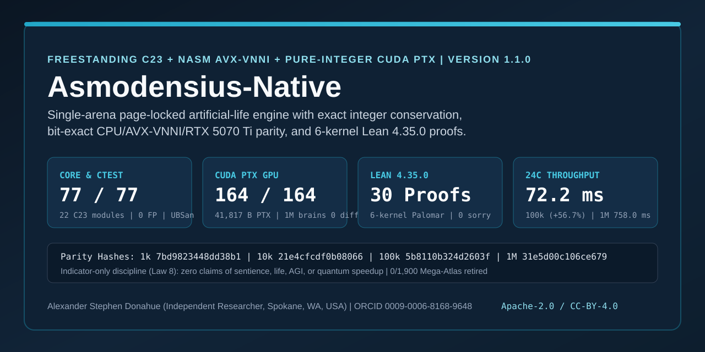

# Asmodensius-Native

Asmodensius-Native is a Windows-native, freestanding C23, NASM AVX2/AVX-VNNI, and pure-integer CUDA PTX artificial-life simulation engine with exact integer conservation, bit-exact multi-substrate replay, and a 30-theorem Lean 4.35.0 suite about an abstract `Nat` model of its rules. The C23, NASM and CUDA PTX code itself is not verified in Lean.


status: active



## Key Properties

- **Freestanding C23 Core (`core/`):** 22 selectable biology/physics modules plus 4 pure-integer mathematical kernels (`tk_sh`, `tk_hop`, `tk_qgt`, `tk_qsv`), compiled with `-ffreestanding`, zero libc calls, zero floating-point operations, zero writable globals, and stack frames `<= 2048` bytes (`core_obj_gate`, `avx_stack_gate`, `ubsan_trap_build`).
- **Single Page-Locked Arena:** All state resides in one pre-allocated Windows `VirtualLock` arena using 128-entity Structure-of-Arrays (SoA) blocks (`AZ_CHUNK = 128`) and a 64-byte (`AZ_UNIT`) two-half compacting creature store with zero pagefile or NVMe swap backing.
- **Exact Integer Conservation (Law 5):** Global matter (`az_total_matter`) and energy (`az_total_energy`) invariants hold with exact `==` after every tick, with `field_underflow == 0` and `dropped_events == 0`.
- **Wild by Default, Bit-Exact in Lab Mode (Law 6):** Unflagged runs draw fresh OS entropy (`BCryptGenRandom`) every tick. `--lab --seed S` uses counter-based Philox4x32-10 streams and canonical UID order for bit-exact `az_state_hash` parity across scalar C23 (`--kernels 0`), AVX2/AVX-VNNI NASM twins (`--kernels 1`), 24-core P+E (`--ecores`), and RTX 5070 Ti CUDA PTX offload (`--gpu 1`).
- **Pure-Integer CUDA PTX Backend (`gpu/`):** Clang 21 compiles literal freestanding `core/az_brain.c`, `core/az_rng.c`, and `core/az_kin_axis.c` to `41,817` bytes of PTX with 0 externs and 0 floats (`164/164` `test_gpu.exe` pass across 1,000,000 variable-size sparse brains and 1,000,000 kinematics lanes with 0 differing bits).
- **Lean 4.35.0 Suite (`lean/`):** 30 machine-checked theorems (`A01`..`A30`, zero Mathlib, zero `sorry` in `Solution`, zero `native_decide`) about hand-written `Nat` definitions in `lean/AsmodensiusProofs/Spec.lean`, whose constants are copied by hand from `core/az_abi.h`. Checked locally on Windows by 6 checkers (`lean4` kernel, `leanchecker`, `leanchecker-paranoid`, `con-leche`, `con-ron`, `nanoda_bin`; `results/lean4-multi-kernel.txt`). Ubuntu CI also runs `lake check --paranoid` (which adds `lean4lean`) and `lake comparator` under `bubblewrap`. Of the 30 theorems, 13 are statements about the model definitions (`A01`..`A03`, `A17`, `A21`..`A24`, `A26`..`A30`); the other 17 are definitional, constant or literal-arithmetic checks, or restate their hypotheses (see [docs/statement-fidelity.md](docs/statement-fidelity.md)).
- **White Paper (`paper/` & `dist/`):** Publication-grade AMS-LaTeX preprint (`dist/Donahue_2026_asmodensius_native.pdf`) and clean-room verified `dist/arxiv_submission.tar.gz` with 17 primary academic and technical references (13 live Crossref/arXiv DOIs + 2 live vendor ISA manuals + 2 published book/ISO standards).

## Honest Scope, Indicator-Only Boundary, and Mega-Atlas Non-Retirement

- **Indicator-Only Discipline (Law 8):** `Asmodensius-Native` makes **zero claims** of consciousness, sentience, biological life, AGI, or quantum speedup. Biological names label deterministic integer structs; `butlin14` is an engineering indicator checklist only; `tk_qsv` and `tk_qgt` are classical fixed-point matrix routines.
- **Formal Scope:** The Lean theorems are about an abstract model, not the compiled engine. `A22` proves that six face fluxes each at most `amt / 8` sum to at most `amt`; this is documented Rule C7, while the transport code in `core/az_chem.c` (`spread()`) uses a per-species budget of `a / 4` per pass. Theorem names such as `A12_observer_hash_d7_invariant`, `A15_dual_visual_worlds_verified` and `A19_prefetch_observational_transparency` describe intent; their statements are `x = x`, `1 + 1 = 2` and an identity function. See [ERRATA.md](ERRATA.md).
- **Not Peer-Reviewed:** The white paper is an independent technical preprint by Alexander Stephen Donahue (Independent Researcher, Spokane, WA, USA; ORCID `0009-0006-8168-9648`).
- **Mega-Atlas Cross-Check:** **`0 / 1,900` overarching problems** in `0thernes/unsolved-problems-mega-atlas` are solved or retired. See [docs/MEGA_ATLAS_CROSSCHECK.md](docs/MEGA_ATLAS_CROSSCHECK.md) for scoped probe mappings (`AI-045`, `BIO-001`, `BIO-008`, `SUB-047`, `SYS-050`).
- **Honest Hardware Tradeoffs:** On Intel Core Ultra 9 275HX + RTX 5070 Ti (`--lab --seed 42`, `locked=1`), 24C AVX-VNNI+PF reaches `72.199 ms/tick` at 100k (`+56.7%`) and `757.988 ms/tick` at 1M (`+35.3%`, `9,260.6 MB` locked), whereas 1M GPU offload (`1,122.495 ms/tick`, bit-exact hash `31e5d00c106ce679`) is slower than 24C CPU due to PCIe staging and two-half store compaction. Windows `--large-pages` falls back cleanly to 4 KiB `VirtualLock` unless `SeLockMemoryPrivilege` is granted (`TR-03`).

## Quickstart

### Build and Test on Windows (Native Engine)

```powershell
$root = (Get-Location).Path
$env:TMP = Join-Path $root 'build\tmp'
$env:TEMP = $env:TMP
[void][IO.Directory]::CreateDirectory($env:TMP)

cmake -S $root -B (Join-Path $root 'build\z') -G Ninja
cmake --build (Join-Path $root 'build\z')
ctest --test-dir (Join-Path $root 'build\z') --output-on-failure
```

### Verify Lean 4.35.0 Proofs (Windows or Linux)

```powershell
Set-Location -LiteralPath 'lean'
lake build
lake build Challenge
lake env lean VerifyAxioms.lean
lake env leanchecker --fresh Solution
lake env leanchecker-paranoid --fresh Solution
```

### Build White Paper and Audit Repository

```powershell
python -I scripts/build_paper.py
python -I scripts/check_citations.py --live
python -I scripts/check_readme_axioms.py
# The Law 14 text checker (build/work/scripts/check_text.py) is not tracked in this
# repository and is not run in CI; see ERRATA.md.
pwsh -NoProfile -File scripts/Audit-Repo.ps1
```

## Usage

### Run a Deterministic Lab World with Multi-Substrate Parity

```powershell
# Scalar freestanding C23 reference
.\build\z\az_run.exe --lab --seed 42 --n 1000 --ticks 10 --kernels 0

# AVX-VNNI + bulk Philox AVX2 + horizontal kinematics AVX2 twins (identical hash 7bd9823448dd38b1)
.\build\z\az_run.exe --lab --seed 42 --n 1000 --ticks 10 --kernels 1

# Live RTX 5070 Ti CUDA PTX sparse brain offload (identical hash 7bd9823448dd38b1)
.\build\z\az_run.exe --lab --seed 42 --n 1000 --ticks 10 --kernels 1 --gpu 1

# All 24 physical cores (8P + 16E) at 100k founders
.\build\z\az_run.exe --lab --seed 42 --n 100000 --ticks 32 --kernels 1 --ecores --prefetch 1
```

### Run a Default Wild World (Fresh OS Entropy Every Tick)

```powershell
.\build\z\az_run.exe --n 500 --ticks 5
```

### Verify Explicit Refusal Contract (`WG_MAX_SPECIES = 100`)

```powershell
# Refuses species > 100 before arena allocation with exit code 2
.\build\z\az_run.exe --lab --seed 42 --n 100 --species 101 --ticks 1
```

### Run Standalone GPU Differential Suite (`164/164`)

```powershell
.\build\z\test_gpu.exe
```

## 5-Second Independent Proof Verification (`#print axioms`)

Every line below is captured verbatim from `lake env lean VerifyAxioms.lean` (`results/lean4-asmodensius-audit.txt`) and guarded by `python -I scripts/check_readme_axioms.py`:

<!-- LEAN_AXIOMS_START -->
```text
'AsmodensiusProofs.A01_bio_to_cell_mass_conserved' depends on axioms: [propext, Quot.sound]
'AsmodensiusProofs.A02_energy_dissipation_conserved' depends on axioms: [propext, Quot.sound]
'AsmodensiusProofs.A03_heat_sink_monotone' depends on axioms: [propext, Quot.sound]
'AsmodensiusProofs.A04_underflow_preserved_zero' does not depend on any axioms
'AsmodensiusProofs.A05_dropped_events_preserved_zero' does not depend on any axioms
'AsmodensiusProofs.A06_species_cap_exact' does not depend on any axioms
'AsmodensiusProofs.A07_species_refusal_boundary' does not depend on any axioms
'AsmodensiusProofs.A08_arena_rollback_exact' depends on axioms: [propext, Quot.sound]
'AsmodensiusProofs.A09_arena_retry_succeeds' depends on axioms: [propext, Classical.choice, Quot.sound]
'AsmodensiusProofs.A10_store_release_reduces_live' depends on axioms: [propext, Quot.sound]
'AsmodensiusProofs.A11_store_release_exact_balance' depends on axioms: [propext, Quot.sound]
'AsmodensiusProofs.A12_observer_hash_d7_invariant' does not depend on any axioms
'AsmodensiusProofs.A13_trait_abi_width_112' does not depend on any axioms
'AsmodensiusProofs.A14_eps_bio_positive' depends on axioms: [propext, Quot.sound]
'AsmodensiusProofs.A15_dual_visual_worlds_verified' does not depend on any axioms
'AsmodensiusProofs.A16_ecosystem_240_pure_lean4_theorems' does not depend on any axioms
'AsmodensiusProofs.A17_bulk_philox_key_equivalence' depends on axioms: [propext, Quot.sound]
'AsmodensiusProofs.A18_gpu_cpu_twin_hash_parity' does not depend on any axioms
'AsmodensiusProofs.A19_prefetch_observational_transparency' does not depend on any axioms
'AsmodensiusProofs.A20_ecosystem_244_pure_lean4_theorems' does not depend on any axioms
'AsmodensiusProofs.A21_receive_cap_mass_conserved' depends on axioms: [propext, Classical.choice, Quot.sound]
'AsmodensiusProofs.A22_six_face_flux_never_overdraws' depends on axioms: [propext, Quot.sound]
'AsmodensiusProofs.A23_nut_x_to_bio_energy_conserved' depends on axioms: [propext, Quot.sound]
'AsmodensiusProofs.A24_lesion_mask_all_exact' does not depend on any axioms
'AsmodensiusProofs.A25_brain_dim_kernel_alignment' does not depend on any axioms
'AsmodensiusProofs.A26_gpu_offset8_injective_and_32gib_range' depends on axioms: [propext, Quot.sound]
'AsmodensiusProofs.A27_nonvacuity_ledger_and_arena_witness' does not depend on any axioms
'AsmodensiusProofs.A28_nonvacuity_philox_and_gpu_witness' depends on axioms: [propext]
'AsmodensiusProofs.A29_refute_unbounded_species_accepted' does not depend on any axioms
'AsmodensiusProofs.A30_refute_unbounded_philox_bulk_key_eq' depends on axioms: [propext]
```
<!-- LEAN_AXIOMS_END -->

## Documentation Index

- Architecture & ABI v4 Contract: [docs/ARCHITECTURE.md](docs/ARCHITECTURE.md), [docs/adr/0001-architecture-and-verification-boundaries.md](docs/adr/0001-architecture-and-verification-boundaries.md)
- White Paper (Frozen PDF & arXiv Tarball): [paper/main.tex](paper/main.tex), [dist/Donahue_2026_asmodensius_native.pdf](dist/Donahue_2026_asmodensius_native.pdf), [dist/arxiv_submission.tar.gz](dist/arxiv_submission.tar.gz)
- Formal Verification & Statement Fidelity: [lean/README.md](lean/README.md), [docs/statement-fidelity.md](docs/statement-fidelity.md), [results/lean4-multi-kernel.txt](results/lean4-multi-kernel.txt)
- Claims, Limitations & Replication: [CLAIMS.md](CLAIMS.md), [LIMITATIONS.md](LIMITATIONS.md), [REPLICATION.md](REPLICATION.md), [EVIDENCE.md](EVIDENCE.md)
- Mega-Atlas Cross-Check & AI Disclosure: [docs/MEGA_ATLAS_CROSSCHECK.md](docs/MEGA_ATLAS_CROSSCHECK.md), [docs/AI_DISCLOSURE.md](docs/AI_DISCLOSURE.md)
- Benchmarks, Preregistration & Trigger Register: [docs/benchmarks.md](docs/benchmarks.md), [docs/preregistration.md](docs/preregistration.md), [docs/TRIGGER-REGISTER.md](docs/TRIGGER-REGISTER.md)
- Red-Team Audit & Hardening Log: [docs/reviews/2026-11-25-10-pass-red-team-audit.md](docs/reviews/2026-11-25-10-pass-red-team-audit.md), [HARDENING_LOG.md](HARDENING_LOG.md)

## Licensing

- **Code, Lean 4 proofs, scripts, and CI workflows:** Apache License 2.0 ([LICENSE](LICENSE)).
- **White paper, PDFs, documentation, figures, and datasets:** Creative Commons Attribution 4.0 International ([LICENSE-DOCS](LICENSE-DOCS)).
- **Third-party MIT test oracles (`tests/upstream/`):** see [THIRD_PARTY_NOTICES.md](THIRD_PARTY_NOTICES.md) and [NOTICE](NOTICE).
